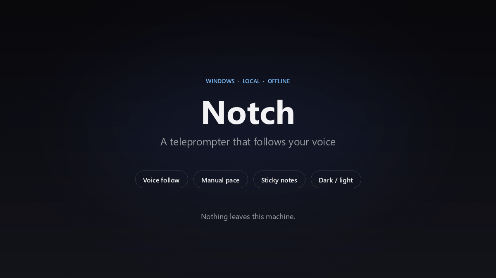
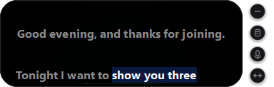
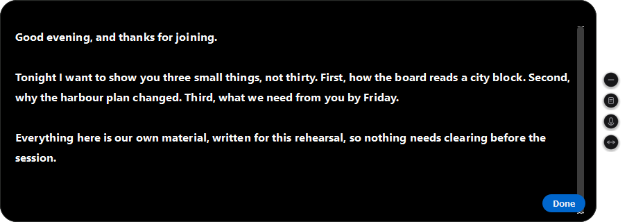
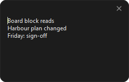

# Notch

Notch is a desktop teleprompter for Windows. It keeps a small card of script text near your webcam, scrolls it as you speak, and stays out of screen captures, so the words do not appear in a recording or a video call.

The card is a PyQt5 overlay with a transparent strip of controls beside it. It is set to stay above other windows. In Voice mode a local speech recogniser follows your reading; in Manual mode the card scrolls at a fixed words-per-minute pace. Scripts, sticky notes, window position, theme and typeface are restored on the next launch.

Speech recognition and head tracking run on this machine. There is no account, no API key, and no network path for audio, transcripts or the script.

## Screenshots



One pass through the app: voice follow, manual pace, the right-click panel, the editor, a sticky note, the narrow reader and the resting pill, setup, help, and each surface again in light. The frames come from the running app, not a mock-up.



The reader mid-reading. The confirmed line is dimmed, and the words being spoken carry the accent band.



The editor, opened by double-clicking the script.



A sticky note, opened with `Ctrl+N`.

## What it does

The reader shows a few words per line at its default size and keeps the line being read at a fixed anchor. Words already spoken are dimmed, the words under the voice carry the brighter accent on a quiet band, and the next two to four words take a quieter accent before the recogniser confirms them. A small waveform at the foot of the card follows the microphone level, and the four floating controls (minimize, new note, mute, narrow/wide) sit outside the text column so no glyph covers a word. While reading, the controls recede after three seconds of stillness and return when the pointer moves.

Double-clicking the script opens an editor for it. A `.txt` file can also be dropped onto the window or opened from the right-click menu. The editor takes a space bar for a space and keeps the reader's shortcuts out of the way while it has the keyboard.

Manual mode has a speed control from 1 to 400 words per minute. The left and right arrow keys change the pace by small steps. Four checkpoints can be set and revisited with the keyboard, which is useful when a talk has sections you may need to return to.

Sticky notes are separate windows. New notes are placed clear of the reader's controls and of each other, and their text survives a restart. Empty notes are dropped rather than saved.

Head tracking is optional and starts off. When it is on, the card moves to follow where you look, using the camera. It never places the card in the lower half of the screen.

## Requirements

- Windows 10 or Windows 11. Capture exclusion needs Windows 10 version 2004 or later; older builds can only blank the window in a capture.
- A microphone. Voice mode needs an input device; Manual mode does not.
- Python 3.13, which is what the existing `.venv` and `build-installer.bat` use. The installer script falls back to the `py -3.13` launcher when `python` is not on `PATH`.
- The model files described below. They are not tracked by git.

## Setup

Create the environment and install the Python packages:

```
python -m venv .venv
.venv\Scripts\python.exe -m pip install -r requirements.txt
```

Put the model files under `model/` at the repository root:

- `model/sherpa/` — the sherpa-onnx streaming zipformer English export, with `tokens.txt` and the encoder, decoder and joiner `.onnx` files. The int8 export is used when both are present. Download `sherpa-onnx-streaming-zipformer-en-2023-06-26.tar.bz2` from the [sherpa-onnx ASR model releases](https://github.com/k2-fsa/sherpa-onnx/releases/download/asr-models/sherpa-onnx-streaming-zipformer-en-2023-06-26.tar.bz2) and extract it so that `model/sherpa/tokens.txt` exists.
- `model/silero_vad.onnx` — the voice-activity detector, from the [sherpa-onnx release](https://github.com/k2-fsa/sherpa-onnx/releases/download/asr-models/silero_vad.onnx).
- `model/face_landmarker.task` — the MediaPipe face landmarker, from [Google's model storage](https://storage.googleapis.com/mediapipe-models/face_landmarker/face_landmarker/float16/1/face_landmarker.task). Head tracking needs this file; the installer build stops without it.
- Optionally, a Vosk model at `model/conf`, `model/am`, `model/graph` and `model/ivector`. It is used as the fallback when no sherpa export is present, so an older installation keeps working.

Without a speech model, Voice mode reports "Speech recognition unavailable — voice match off" and the rest of the app still runs. `tests/check_speech_engine.py` reports SKIP for the same reason.

## Running from a checkout

```
.venv\Scripts\python.exe main.py
```

`main.py` is the compatibility launcher; the application itself is `notch.app.main`. `python run.py` is the development launcher and installs the requirements on first use if PyQt5 or sounddevice is missing. `python -m notch` also works. `start-notch.bat` uses `main.py` and appends stdout and stderr to `notch-run.log`.

The first Voice session loads the acoustic model before it can hear anything. The menu's status line says it is loading. On the machine used for the engine benchmark that load took 4.2 seconds; the loaded engine is reused until the process exits, so switching to the editor and back does not pay it again.

## Building a Windows installer

```
build-installer.bat 1.6.1
```

The script creates or reuses `.venv`, installs the requirements plus PyInstaller, checks for the model files, freezes the app with `packaging/notch.spec`, copies `model/` beside `Notch.exe`, and compiles the installer with Inno Setup 6. The result is `dist\NotchSetup-<version>.exe`. Inno Setup can be installed with `winget install JRSoftware.InnoSetup`.

## Using Notch

### The card

- Double-click the script to edit it. Done or Escape returns to reading.
- Drag the card with the left mouse button to move it. Its position is saved and clamped to a screen that still exists.
- The minus control shrinks the card to a resting pill; click the pill to bring it back.
- The narrow/wide control changes the reading width. The narrow card shows about two words per line.
- The microphone control mutes or unmutes the recogniser. A muted mic reads as a resting pill, not as a live one.
- Right-click the card or the script for mode, speed, font size, typeface, theme, head tracking, global keys, Load Script, Help, Setup and Quit.

### Keyboard, while Notch has focus

| Keys | Action |
| --- | --- |
| `Space` | Start or pause Manual scrolling |
| `Left` / `Right` | Slower / faster |
| `Ctrl+R` | Return to the beginning |
| `Ctrl+=` / `Ctrl+-` | Larger / smaller script |
| `Ctrl+1` … `Ctrl+4` | Set checkpoint |
| `Ctrl+Shift+1` … `Ctrl+Shift+4` | Jump to checkpoint |
| `Ctrl+N` | New sticky note |
| `Ctrl+Shift+H` | Turn head tracking on or off |
| `Escape` | Back out one level: pill, editor, a running Manual scroll, then close |

### Global keys

Manual playback normally needs the reader to own the keyboard, which is exactly what it does not have during a presentation. **Global keys** is an opt-in row in the menu and in Setup. When it is on, Notch registers three chords with Windows:

- `Ctrl+Shift+Space` starts or pauses Manual scrolling.
- `Ctrl+Alt+Left` and `Ctrl+Alt+Right` change the pace.

These are delivered while another application is in front, without taking focus. A registration that another application already owns is reported, with Windows error 1409, instead of being retried silently. Voice mode ignores the chords and releases them. Closing the reader releases them as well. The play/pause chord can be changed in Setup among three choices; the speed chords are fixed so the help text can state them.

### Voice commands

Say one of these while Voice mode is listening. They are matched from a final transcript, not from a partial one, and they work with or without a script loaded:

- "Notch restart" returns to the beginning.
- "Notch expand" opens or closes the editor.
- "Notch mute" mutes or unmutes the microphone.
- "Notch close" closes Notch.

The recogniser sometimes writes "not" instead of "Notch"; both forms are accepted.

### Head tracking

Head tracking is experimental and off by default. Turn it on from the menu or with `Ctrl+Shift+H`. The camera opens at 640×480 and requests 15 frames per second; the worker achieved about 14.7 Hz on the test machine. MediaPipe's face landmarker finds 478 points per face, including both irises.

The screen's upper half is divided into five columns and two rows. Head position and face direction choose a region; the irises refine the position inside that region. The card eases to a region on a spring and is clamped so the words cannot enter the lower half. Calibration measures the neutral pose from a still window when tracking is switched on, a dead zone keeps a still head still, and hysteresis stops a head on a boundary from rattling between cells.

Turning tracking off releases the camera. Turning it back on reuses the loaded model and the same worker. If no face is visible, the log says so rather than leaving a switch on that does nothing. A camera that has delivered one frame is retried with a capped delay instead of being declared failed, so a video call that briefly takes the device does not turn the feature off for good.

## Where your data goes

The app stores its own state under `%APPDATA%\NotchFree`:

- `state.json` holds the script, the notes, the settings, the reader's position and the time it was last written. `state.json.bak` is the previous good copy; the primary file is replaced atomically.
- `speaking-profile.json` holds aggregate speech timings for the predictive shading: words per second, pause length and five duration weights. It contains no audio, transcript or script. `speaking-profile.json.bak` is its previous good copy. Deleting both resets the estimate to the default pace.

An update never starts from an empty state. A file written by an older build is upgraded on load, with the original kept as `state.json.v<schema>.bak` or `speaking-profile.json.v<schema>.bak` before the first rewrite. A file from a newer build is read for the fields this build understands and snapshotted the same way, so downgrading or reinstalling does not erase the newer data on disk.

Each launch also keeps one timestamped copy of the state and speaking profile it found, named like `state.json.2026-11-14T16-47-03-123456.bak`. The newest ten are kept, so a session opened by mistake can be recovered after the next one has started. `tests/check_storage.py` lists them; they are never loaded automatically.

Audio is captured at 16 kHz mono and decoded by a local model. `tests/check_speech_engine.py` patches socket calls to raise, then loads the model and decodes a sentence, so a network path in the recognition stack fails the check rather than passing unnoticed. Nothing records audio. The optional `tests/check_predictive_speech.py --live` does write a reading and its measurements into `.sessions/`, which git ignores; `--replay` decodes that recording again through the same recogniser.

Every app window (the reader, notes, menu and dialogs) asks Windows to exclude it from screen capture with `SetWindowDisplayAffinity`. On Windows 10 2004 and later this removes the window from captures; older builds get the monitor-blank fallback. A capture path that ignores display affinity, such as an external capture card, is outside what Windows can hide.

Global keys are off until you switch them on. Only the three configured chords are read. No key is logged or sent anywhere, and the chords are released when the mode changes, the setting is switched off, or the app exits.

Head tracking stays on the machine. Frames are inspected in memory and discarded; only a few floats leave the worker. The landmark model is a file in `model/`, not a download, so switching the feature on does not open a connection either.

## How the reading works

Audio arrives in 16 kHz mono blocks of 100 ms. A Silero voice-activity detector decides whether anyone is speaking, which lets the worker skip decoding silence and gives the reader a 0.75 second trailing silence as the end of an utterance. The recogniser is a sherpa-onnx streaming zipformer transducer with two threads; a Vosk/Kaldi model is the fallback. In the engine benchmark on the reference machine the zipformer decoded at 14.8× realtime, using 68 ms of CPU per second of audio, against 4.3× for the Vosk model it replaced. The detector cost 6 ms per audio second. Those figures come from one machine; the selection rests on the relative order.

The matching engine aligns what the recogniser hears with the script rather than assuming the two texts are identical. Partial results drive the shading; the reading line advances only when the line's last word is confirmed by a close match, so the scroll cannot run ahead of the voice. Numbers are canonicalised on both sides, because scripts print `60` where a speaker says "sixty". A sentence the recogniser misses entirely can be re-anchored, but only after a second consecutive final that confirms nothing and only onto three strongly matching words, so a cough or a repeated phrase does not jump the reader.

The predictive layer estimates which words fit in the recogniser's delay and a reaction window. It combines an adaptive speaking rate, a five-weight online timing model and a pause state; the estimate stops growing while the voice-activity detector reports silence. Paint advances one word at a time, retreats only after being wrong for 0.7 seconds, and cannot leave the rendered line. The design, the tuning constants and the measured coverage are in [docs/predictive-highlight.md](docs/predictive-highlight.md).

Movement uses a spring that carries its velocity, so a change of direction mid-flight bends rather than restarts. The card's size, position and open script are restored from the state file, and a position saved on a monitor that has since been removed is clamped to a screen that exists.

## Checks

Run these from the repository root. The offscreen ones do not need a visible desktop.

```
QT_QPA_PLATFORM=offscreen .venv/Scripts/python.exe tests/check_behavior.py
QT_QPA_PLATFORM=offscreen .venv/Scripts/python.exe tests/check_voice_follow.py
QT_QPA_PLATFORM=offscreen .venv/Scripts/python.exe tests/check_waveform.py
QT_QPA_PLATFORM=offscreen .venv/Scripts/python.exe tests/check_speech_engine.py
QT_QPA_PLATFORM=offscreen .venv/Scripts/python.exe tests/check_robustness.py
QT_QPA_PLATFORM=offscreen .venv/Scripts/python.exe tests/check_note_clearing.py
QT_QPA_PLATFORM=offscreen .venv/Scripts/python.exe tests/check_note_placement.py
QT_QPA_PLATFORM=offscreen .venv/Scripts/python.exe tests/check_upgrades.py
QT_QPA_PLATFORM=offscreen .venv/Scripts/python.exe tests/check_head_tracking.py
.venv/Scripts/python.exe tests/check_storage.py        # read-only data report
QT_QPA_PLATFORM=offscreen .venv/Scripts/python.exe tests/check_predictive_highlight.py
QT_QPA_PLATFORM=offscreen .venv/Scripts/python.exe tests/bench_predictive_highlight.py
QT_QPA_PLATFORM=offscreen .venv/Scripts/python.exe tests/check_predictive_speech.py
QT_QPA_PLATFORM=offscreen .venv/Scripts/python.exe tests/profile_reading.py
.venv/Scripts/python.exe tests/check_design.py      # needs a real display
.venv/Scripts/python.exe tests/check_quality.py     # needs a real display
.venv/Scripts/python.exe tests/check_hotkeys.py     # needs Windows and a real display
```

`tests/check_hotkeys.py` registers the real system-wide chords, presses them with OS-level keyboard events while another application owns the foreground, and checks delivery, focus preservation, conflict reporting, the Voice-mode no-op and release on close. `tests/verify_installed.py` runs the same checks against an installed build, backing up and restoring the saved state around the run.

`tests/check_head_tracking.py` drives the motion layer with explicit timestamps at the worker's measured cadence, covers all ten regions, continuity, bounds, calibration, dead zones, hysteresis, jitter, fusion, release and disable, then exercises the real worker against a simulated camera. `tests/measure_head_tracking.py` is the real-camera half and SKIPs when there is no camera or no face.

`tests/check_predictive_highlight.py` scores the anticipatory layer; `tests/bench_predictive_highlight.py` runs a known speaker timeline through the predictor and reports coverage, lead, precision, flicker and update cost. The constants in `notch/audio/predict.py` were chosen against that benchmark. `tests/check_predictive_speech.py` decodes three SAPI sentences with the installed model and drives the real overlay; `--live` uses the production microphone worker and records the reading, and `--replay <session>` decodes it again, which makes one human reading a repeatable benchmark. Sessions land in `.sessions/` and stay local.

`tests/profile_reading.py` drives the real overlay offscreen at recogniser cadence and reports frame cadence, result-to-paint latency, CPU and working set. `tests/calibrate_voice.py` scores a speaker against the recording corpus and can drive the overlay with those takes. Recordings remain local WAV files.

`tests/check_design.py` asserts surface invariants against rendered pixels and needs the platform's font database, so it fails offscreen even on unchanged code. `tests/verify_ui.py` reports window geometry and can assert the capture affinity.

All checks build their own temporary store, so they do not touch the saved script or notes.

## Project layout

```
notch/
  app.py            Qt start-up
  ui/               card, controls, dialogs, notes, motion
  audio/            microphone worker, recognition, matching, prediction
  tracking/         camera source and head/eye motion
  platform/         Windows capture exclusion and global hotkeys
  storage/          atomic state persistence
  paths.py          shared model and install paths
main.py             compatibility launcher (notch.app.main)
run.py              development launcher
tests/              behaviour checks, benchmarks and screenshot harnesses
packaging/          PyInstaller spec and Inno Setup script
model/              local speech and face models (not tracked)
```

`notch.app.main` is the real entry point. `main.py` exists because `start-notch.bat`, the PyInstaller spec and older instructions all use `python main.py`.

## Known limits

- Scripts are plain `.txt`. The picker and the drop target accept nothing else; there is no PDF or DOCX import.
- Capture exclusion and global keys use Windows APIs. There is no macOS or Linux path in the code, and nothing in `tests/` exercises another platform.
- The predictive shading cannot paint past the end of the rendered line, and the line advances only on a confirmed word. At the default width a fluent reading gets at most about one line of lead. The measured coverage in `docs/predictive-highlight.md` is an upper bound for a real reader, not a promise.
- Head tracking is experimental. It needs a camera, a visible face and the landmark model; it calibrates the neutral pose each time it is switched on, so a different posture needs a fresh enable. The harness checks the thresholds and fusion behaviour, but they have not been validated across a range of speakers.
- The model this setup uses is English. Accuracy varies with microphone, room and accent; the accent figures in `docs/ui-audit/README.md` come from one speaker, and `tests/calibrate_voice.py` is what would measure another.
- The Vosk fallback requires an existing model folder in the old layout. A fresh checkout without one uses sherpa-onnx only.
- The engine numbers in this file were measured on one machine. Relative costs are what the design relies on; absolute latencies will differ elsewhere.

## License

Distributed under the MIT License. See [LICENSE](LICENSE).
