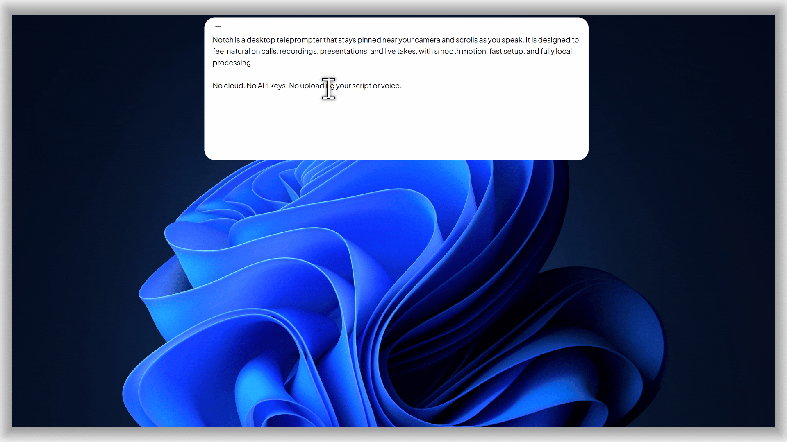

  

    
  

  <h1 align="center"><b>Notch - Smart Teleprompter for macOS & Windows</b></h1>
  

    A local, offline teleprompter that follows your voice.
     
    Built for creators, presenters, interviews, meetings, and live delivery.
     
     
    <b>Downloads for </b>
    <a href="https://socia.ae/products/notch">macOS & Windows</a>
     
  

 

  

How to Use Notch: https://www.youtube.com/watch?v=8LaDcjB6gCM

Notch is a desktop teleprompter that stays pinned near your camera and scrolls as you speak. It is designed to feel natural on calls, recordings, presentations, and live takes, with smooth motion, fast setup, and fully local processing.

No cloud. No API keys. No uploading your script or voice.

---

## Features

| Feature | Description |
| :--- | :--- |
| **Voice follow** | Scrolls with your speech so the script moves when you talk and settles when you pause. |
| **Invisible in capture workflows** | Built to stay out of screen recordings and video calls while you present. |
| **Smooth reading motion** | Uses tuned spring-based scrolling so movement feels natural and easy to track. |
| **Offline speech processing** | Runs locally without sending your script or voice to the cloud. |
| **Manual mode** | Lets you run the teleprompter at a fixed pace when you want full control. |
| **Always on top** | Stays near your webcam so your eyeline remains more natural on camera. |
| **Document import** | Load `.txt` scripts from the menu or drag them directly onto Notch. |

---

## Use cases

- **Presentations**: Keep your delivery smooth without looking down at notes.
- **Video recording**: Read scripts naturally while keeping your eyes close to the camera.
- **Meetings and demos**: Stay on message with key talking points always in view.
- **Interviews and podcasts**: Track questions, intros, and transitions without losing flow.
- **Live streaming**: Follow prepared segments with a cleaner, more confident delivery.

---

## How it works

1. Double-click Notch to open the editor, paste your script, or load a `.txt` document from the menu.
2. Minimize back into the pill and position Notch near your webcam.
3. Choose between Voice mode and Manual mode from the right-click menu.
4. Use the right-click menu any time to adjust font, theme, speed, microphone, and presentation settings.

### Modes

- **Voice mode**: Voice Follow stays active while you speak, helping the script track your delivery.
- **Manual mode**: Scroll at a controlled pace when you prefer a fixed rhythm instead of speech-driven movement. `Space` and the arrow keys work while Notch has the keyboard; switch **Global keys** on in the right-click menu (or Setup) and `Ctrl+Shift+Space` starts or pauses from any application, with `Ctrl+Alt+Left / Right` for the pace, without taking focus away from what you are presenting in.

---

## Privacy

Notch is built for local-first use. Audio processing happens on your machine, and the app is designed around offline teleprompting rather than cloud transcription workflows.

Speech recognition runs from a model on disk (sherpa-onnx with a Silero voice-activity detector, or a local Vosk model as the fallback). There is no network path for microphone audio, transcripts or your script: `tests/check_speech_engine.py` fails if loading or decoding tries to open a socket.

Global keys are **off by default** and opt-in. When switched on, Notch registers three 
chords with Windows and does nothing else with the keyboard: no key is logged, 
recorded or sent anywhere, and the chords are released when the mode changes to 
Voice, when the setting is switched off, and when the app exits.

Optional head tracking is **off by default** and experimental. When switched on it reads the webcam through MediaFoundation's shared mode where available, at 640×480 and 15 fps, so a video call can usually keep the camera. Frames are inspected in memory for a face position and then discarded: nothing is recorded, written or sent anywhere. Only two numbers leave that worker. Turning it off releases the camera immediately. If the camera cannot see a face it says so in the log instead of sitting there looking switched on and inert.

The card itself then travels with your head — up to 150 px sideways and 100 px vertically, and never past the edge of your screen — so the words stay put relative to your eyes instead of leaving them.

Detection runs a frontal cascade, and only when that finds nothing a profile cascade on a half-size copy of the frame and on a mirrored copy of that, so a face turned either way is still found while a face looking at the lens costs one search instead of three. A turned head holds your last position for a second rather than sending the card home mid-read; if you really have left, the words return to where they started.

---

## License

Distributed under the MIT License. See [LICENSE](LICENSE) for more information.

---

## Star History

